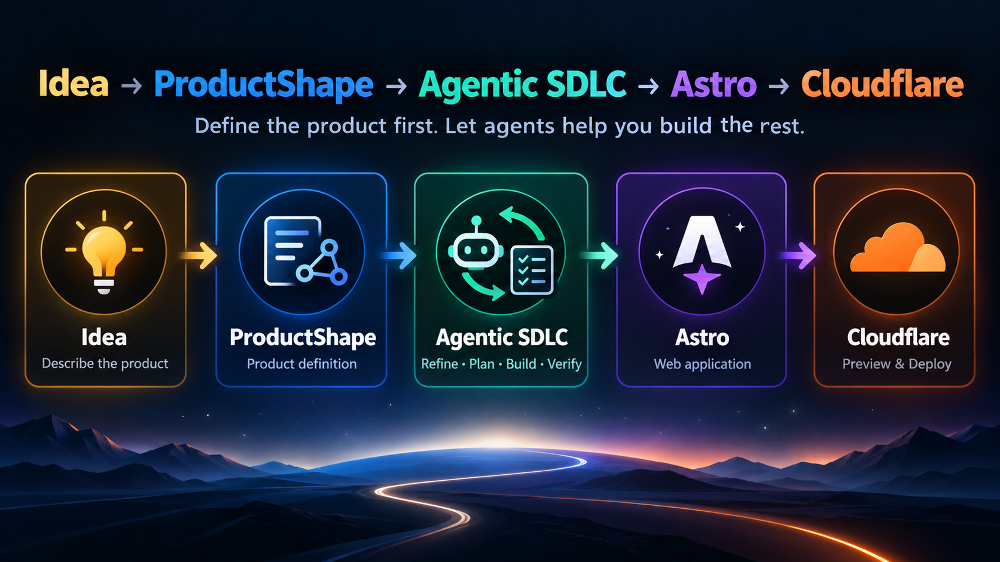

# ProductShape Web Starter

<p align="center">
  
</p>

<p align="center">
  <strong>Define the product first. Let agents help you build the rest.</strong>
</p>

<p align="center">
  <a href="https://www.npmjs.com/package/@prodshape/cli">
    
  </a>
  <a href="https://github.com/juangcarmona/productshape">
    
  </a>
  <a href="https://github.com/juangcarmona/agent-toolkit">
    
  </a>
</p>

<p align="center">
  <a href="https://astro.build/">
    
  </a>
  <a href="https://www.cloudflare.com/">
    
  </a>
  <a href="https://firebase.google.com/">
    
  </a>
</p>

<p align="center">
  <a href="https://www.typescriptlang.org/">
    
  </a>
  <a href="https://nodejs.org/">
    
  </a>
  <a href="https://pnpm.io/">
    
  </a>
</p>

<p align="center">
  <a href="https://github.com/features/actions">
    
  </a>
  <a href="https://typicode.github.io/husky/">
    
  </a>
  <a href="https://github.com/gitleaks/gitleaks">
    
  </a>
</p>

---

A reusable starter for building **small, production-quality web products** with product definition, design and architecture guardrails, agentic delivery, automated verification, preview environments and near-zero operational cost.

## Stack

| Area | Technology | Purpose |
| --- | --- | --- |
| Product | [ProductShape](https://github.com/juangcarmona/productshape) | Product Definition as Code |
| Delivery | [agent-toolkit](https://github.com/juangcarmona/agent-toolkit) | Refine → plan → implement → verify → integrate |
| Web | [Astro](https://astro.build/) | Static-first web application |
| Hosting | [Cloudflare](https://www.cloudflare.com/) | Builds, previews and production deployment |
| Backend | [Firebase](https://firebase.google.com/) | Optional authentication and mutable private state |
| Language | [TypeScript](https://www.typescriptlang.org/) | Type-safe application code |
| Runtime | [Node.js](https://nodejs.org/) | Build and repository tooling |
| Packages | [pnpm](https://pnpm.io/) | Deterministic dependency management |
| CI | [GitHub Actions](https://github.com/features/actions) | Verification and product snapshots |
| Hooks | [Husky](https://typicode.github.io/husky/) | Local guardrails |
| Security | [Gitleaks](https://github.com/gitleaks/gitleaks) | Secret scanning |

## From idea to product

```text
Idea
  ↓
CHG-INITIAL
  ↓
Accepted ProductShape model
  ↓
Design + Architecture
  ↓
Vertical delivery slices
  ↓
Refine → Plan → Implement → Verify → Integrate
  ↓
Cloudflare Preview
  ↓
Production
```

The backlog is derived from the product definition.

It is **not** the source of truth.

## Product definition

Canonical product intent lives under:

```text
docs/product/model/
```

New products normally begin with a ProductShape change:

```text
CHG-INITIAL
→ refine
→ validate
→ human approval
→ apply
→ accepted baseline
```

Product changes remain explicit and reviewable throughout the life of the product.

## Design

Design evidence and rules live under:

```text
docs/design/
```

The starter supports:

- brand evidence;
- design foundations;
- tokens;
- component and pattern guidance;
- accessibility checks;
- automated design guardrails.

The goal is to give humans **and coding agents** enough constraints to preserve the visual system.

## Architecture

Architecture lives under:

```text
docs/architecture/
```

It describes how accepted product intent is implemented without redefining the product itself.

The default bias is:

- static first;
- minimal infrastructure;
- external resources over unnecessary duplication;
- zero-ops where possible;
- free tiers where realistic.

## Astro

Astro provides the executable web application:

```bash
pnpm dev
pnpm build
```

Static output is preferred unless the product genuinely requires server-side execution.

## Firebase

Firebase is optional.

For products with a private area it can provide:

- Google authentication;
- explicit membership;
- Firestore;
- data-layer authorization;
- emulator-based security-rule tests.

Authentication does not automatically imply authorization.

## Cloudflare

Cloudflare provides preview and production environments.

```text
Pull Request
→ Build
→ Preview

main
→ Build
→ Deploy
```

The starter begins with static assets and avoids additional Cloudflare services unless product requirements justify them.

## Verification

One command should verify the repository:

```bash
pnpm verify
```

Depending on enabled capabilities, this includes:

- design checks;
- type checking;
- tests;
- ProductShape validation;
- ProductShape integrity;
- Firebase Rules tests;
- secret scanning;
- build verification.

A shorter development loop may use:

```bash
pnpm verify:fast
```

## Product snapshots

The accepted ProductShape model can be rendered as a standalone HTML snapshot:

```bash
pnpm exec prodshape graph --format html
```

CI can attach that snapshot to a GitHub Actions run for review without introducing another hosted application.

Generated snapshots are derived output.

The Markdown model remains canonical.

## Agentic delivery

The intended loop is:

```text
Refine
→ Ready
→ Plan
→ Implement
→ Verify
→ Review
→ Integrate
```

Agents are expected to inspect:

```text
docs/product/model/
docs/design/
docs/architecture/
```

before implementing product behaviour.

## Starting a new product

Create a repository from the template and describe:

- what you are building;
- who uses it;
- what is public;
- what is private;
- what content already exists;
- where that content lives;
- who can edit what;
- logo and visual identity;
- important constraints;
- explicit non-goals;
- acceptable operational cost.

Then:

```text
Describe
→ Define
→ Design
→ Architect
→ Slice
→ Build
→ Verify
→ Preview
→ Ship
```

## Good fit for

- bands and music groups;
- schools and courses;
- associations and clubs;
- community websites;
- portfolios and professional sites;
- small internal products;
- public websites with lightweight private areas.

## Principles

- **Product before backlog**
- **Vertical slices over horizontal layers**
- **Static by default**
- **Zero-ops when possible**
- **Explicit product changes**
- **Automated verification**
- **Guardrails over agent prompting**
- **Free tiers where realistic**

> The reusable asset is not the website.  
> It is the system that helps humans and agents build it consistently.